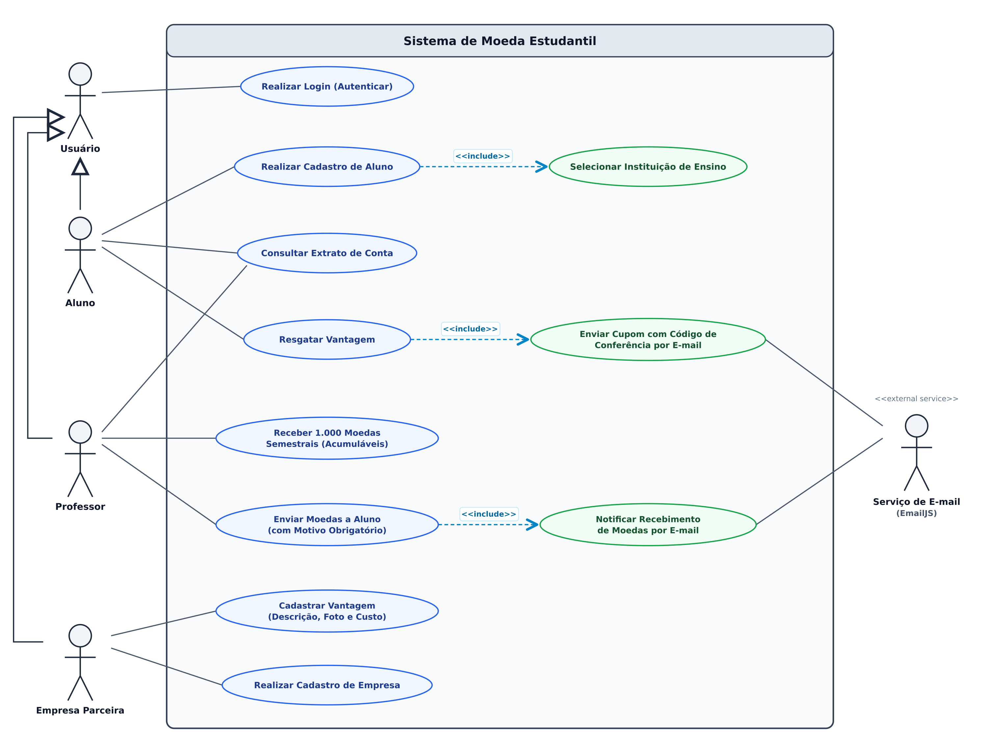
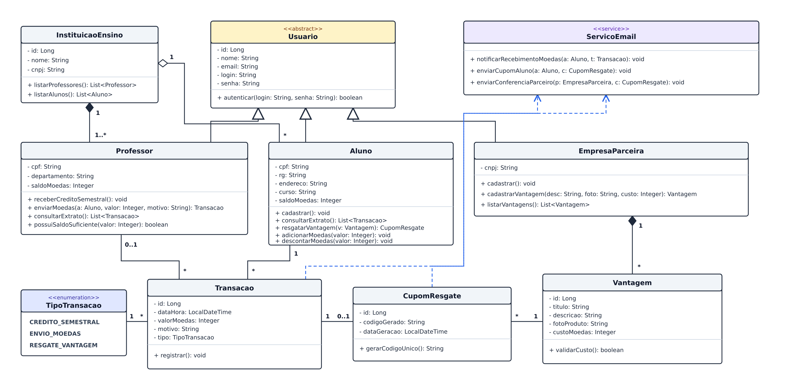
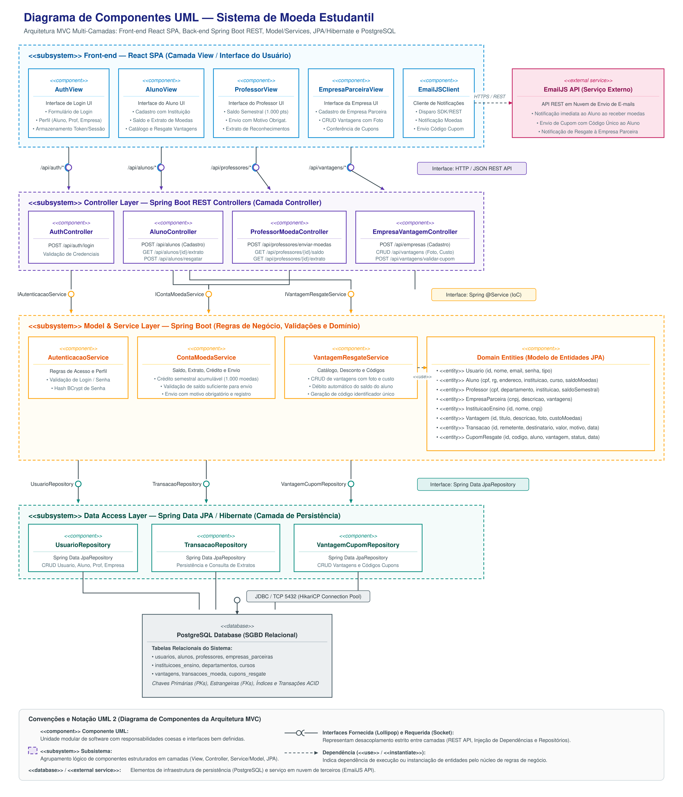
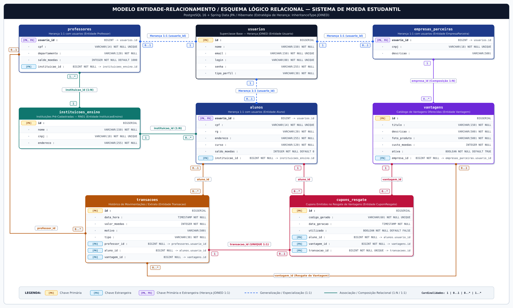

# Sistema de Moeda Estudantil — Laboratório 3

**Laboratório de Desenvolvimento de Software — PUC Minas**  
**Docente:** Profa. Milena Menezes Adão  

### Integrantes da Equipe
- **Fabrício Rocha Lopes**
- **Gabriel Silva Neiva Amaro**
- **Otávio Chaves Silva**
- **Samuel Rocha Ferraz Gonçalves Rebula**

---

## 1. Visão Geral do Sistema

O **Sistema de Moeda Estudantil** é uma plataforma concebida para fomentar o reconhecimento acadêmico e incentivar o engajamento estudantil por meio de meritocracia distribuída. O ecossistema opera sobre uma moeda virtual própria:

- **Distribuição e Reconhecimento:** Os professores recebem semestralmente uma cota fixa de 1.000 moedas, a qual é estritamente cumulativa (o saldo não utilizado em semestres anteriores permanece ativo). Ao reconhecer o bom desempenho, dedicação ou participação relevante de alunos em sala ou projetos, o professor transfere quantias de moedas para os discentes, sendo mandatório o preenchimento de uma justificativa textual aberta explicando a motivação do mérito.
- **Consumo e Vantagens:** Empresas parceiras previamente cadastradas no sistema disponibilizam um catálogo de produtos e vantagens (tais como descontos em restaurantes universitários, materiais de estudo, cursos extras e itens de consumo). O aluno acumula as moedas recebidas e pode resgatar as vantagens desejadas sempre que possuir saldo suficiente.
- **Conferência e Notificação:** Cada transferência de moedas dispara uma notificação automática por e-mail para o aluno agraciado. Quando ocorre um resgate de vantagem, o sistema debita imediatamente as moedas do aluno e gera um cupom com código alfanumérico único de conferência, transmitido simultaneamente por e-mail para o aluno (para apresentação presencial na retirada) e para a empresa parceira (para validação do cupom).

---

## 2. Arquitetura do Sistema (Padrão MVC)

O projeto foi concebido seguindo o padrão arquitetural **MVC (Model-View-Controller)**, assegurando separação clara de responsabilidades, manutenibilidade e escalabilidade:

- **View (Front-end SPA):** Interface gráfica desenvolvida em **React** (utilizando **Vite** como ferramenta de build). Organizada em telas modulares para cada ator (`AuthView`, `AlunoView`, `ProfessorView` e `EmpresaParceiraView`), consumindo os endpoints REST do Back-end de forma assíncrona.
- **Controller (Back-end REST API):** Construído sobre **Java + Spring Boot** (`Spring Web REST`), provendo controllers REST (`AuthController`, `AlunoController`, `ProfessorMoedaController`, `EmpresaVantagemController`) responsáveis pelo mapeamento de rotas HTTP, validação de payload, autenticação e despacho para a camada de serviços.
- **Model & Service (Camada de Negócio e Domínio):** Composto pelas entidades ricas de domínio (`Usuario`, `Aluno`, `Professor`, `EmpresaParceira`, `InstituicaoEnsino`, `Vantagem`, `Transacao`, `CupomResgate`) e pelos serviços especializados (`AutenticacaoService`, `ContaMoedaService`, `VantagemResgateService`), onde residem as regras de validação de saldo, cumulatividade de créditos e geração de cupons.
- **Data Access & Persistência:** Implementado com **Spring Data JPA** e **Hibernate ORM**, fornecendo abstração de repositórios (`UsuarioRepository`, `TransacaoRepository`, `VantagemCupomRepository`) sobre o banco de dados relacional **PostgreSQL** (executado em contêiner Docker ou instância local).
- **Serviço de Comunicação Externa (E-mail):** Integração com o serviço **EmailJS** via requisições REST/HTTPS (`EmailJSClient`), possibilitando o disparo automatizado e auditável das mensagens de reconhecimento e dos códigos de validação de cupons.

---

## 3. Histórias de Usuário (User Stories)

Abaixo constam as dez Histórias de Usuário detalhadas, cobrindo integralmente as necessidades dos atores e as regras de negócio estipuladas para o sistema.

---

### US01 — Realizar Login / Autenticação
- **História:** *Como* usuário do sistema (Aluno, Professor ou Empresa Parceira), *eu quero* me autenticar informando login e senha válidos, *para que* eu possa acessar as funcionalidades restritas e seguras do meu perfil na plataforma.
- **Critérios de Aceitação:**
  1. O sistema deve validar as credenciais informadas contra a base de usuários cadastrados e verificar o hash seguro da senha.
  2. Em caso de sucesso, o sistema deve iniciar uma sessão de usuário autenticada e redirecionar para a interface correspondente ao perfil (`ALUNO`, `PROFESSOR` ou `EMPRESA_PARCEIRA`).
  3. Se o login ou a senha estiverem incorretos, o sistema deve apresentar uma mensagem de erro clara ("Credenciais inválidas") sem expor detalhes internos.
  4. Nenhuma operação de consulta de extrato, transferência de moedas, cadastro de vantagens ou resgates deve ser permitida sem autenticação prévia ativa.

---

### US02 — Realizar Cadastro de Aluno
- **História:** *Como* aluno interessado no programa de moeda estudantil, *eu quero* realizar meu autocadastro na plataforma informando meus dados pessoais, curso e selecionando minha instituição de ensino, *para que* eu possa possuir uma conta ativa e receber moedas dos meus professores.
- **Critérios de Aceitação:**
  1. O formulário de cadastro deve solicitar obrigatoriamente: Nome completo, E-mail, CPF, RG, Endereço residencial, Instituição de Ensino e Curso.
  2. O campo de Instituição de Ensino deve ser uma seleção obrigatória baseada exclusivamente nas instituições previamente cadastradas no sistema.
  3. O CPF e o E-mail informados devem ser validados quanto à unicidade, rejeitando duplicidades no banco de dados.
  4. O saldo inicial de moedas da conta do aluno deve ser configurado automaticamente com valor zero (`0`).

---

### US03 — Realizar Cadastro de Empresa Parceira
- **História:** *Como* representante de uma empresa parceira, *eu quero* cadastrar minha organização na plataforma com dados corporativos e credenciais de acesso, *para que* eu possa oferecer vantagens aos alunos da rede acadêmica.
- **Critérios de Aceitação:**
  1. O formulário de cadastro deve exigir os seguintes campos: Razão Social/Nome Fantasia, CNPJ, E-mail institucional de contato, Login e Senha.
  2. O CNPJ deve ser validado quanto ao formato e à unicidade cadastral no sistema.
  3. A senha deve ser criptografada antes de ser armazenada no banco de dados.
  4. Após o cadastro concluído com êxito, a empresa parceira deve conseguir realizar login e acessar o painel de gestão de vantagens.

---

### US04 — Cadastrar Vantagem
- **História:** *Como* empresa parceira autenticada, *eu quero* cadastrar novas vantagens contendo descrição, foto do produto e custo em moedas, *para que* elas fiquem disponíveis para resgate no catálogo acessado pelos alunos.
- **Critérios de Aceitação:**
  1. O cadastro da vantagem deve conter obrigatoriamente: título/nome curto, descrição detalhada do benefício/produto, imagem/foto do produto (URL válida ou upload de arquivo) e o custo em moedas.
  2. O custo em moedas deve ser um número inteiro estritamente positivo (`custoMoedas > 0`).
  3. A vantagem cadastrada deve ser associada à empresa parceira logada e marcada inicialmente como ativa no catálogo geral.
  4. O sistema deve validar e impedir a submissão do formulário caso qualquer um dos campos mandatórios (descrição, foto ou custo) esteja ausente.

---

### US05 — Receber Crédito Semestral de Moedas
- **História:** *Como* professor participante, *eu quero* que minha conta receba um aporte de 1.000 moedas virtuais a cada novo semestre letivo de forma cumulativa, *para que* eu tenha saldo suficiente para reconhecer o mérito dos meus alunos.
- **Critérios de Aceitação:**
  1. No início de cada período letivo, o sistema deve adicionar exatamente 1.000 moedas ao saldo do professor.
  2. O saldo de semestres anteriores não expira e não é zerado: o novo crédito de 1.000 moedas é somado integralmente ao saldo remanescente existente.
  3. A operação deve gerar automaticamente um registro no extrato do professor do tipo `CREDITO_SEMESTRAL` com data, hora e valor creditado.
  4. Somente professores ativos e vinculados a instituições de ensino cadastradas recebem o crédito semestral.

---

### US06 — Enviar Moedas a Aluno
- **História:** *Como* professor autenticado, *eu quero* transferir uma quantia de moedas da minha conta para um aluno específico acompanhada de uma justificativa textual obrigatória, *para que* eu possa reconhecer e valorizar o seu mérito acadêmico.
- **Critérios de Aceitação:**
  1. O professor deve selecionar o aluno beneficiário a partir de uma listagem ou busca por nome/matrícula/CPF.
  2. O professor deve informar o valor de moedas a ser transferido (número inteiro positivo) e uma mensagem textual aberta explicando o motivo do reconhecimento.
  3. O campo de motivo é de preenchimento obrigatório; o sistema deve rejeitar envios com justificativa vazia ou apenas com espaços em branco.
  4. O sistema deve validar se o professor possui saldo suficiente (`saldoMoedas >= valorTransferencia`). Caso o saldo seja insuficiente, o envio é bloqueado exibindo mensagem de erro.
  5. Havendo saldo suficiente, o valor é deduzido imediatamente do saldo do professor e acrescido ao saldo do aluno, gerando uma transação do tipo `ENVIO_RECONHECIMENTO` no extrato de ambos.

---

### US07 — Receber Notificação de Moedas por E-mail
- **História:** *Como* aluno agraciado com moedas, *eu quero* receber uma notificação automática no meu endereço de e-mail com os detalhes do reconhecimento, *para que* eu seja informado do novo saldo e leia o motivo registrado pelo professor.
- **Critérios de Aceitação:**
  1. Concluída a transferência com sucesso na `US06`, o sistema aciona o serviço de e-mail (EmailJS) de maneira assíncrona.
  2. O e-mail enviado ao aluno deve conter: nome do professor remetente, quantidade de moedas creditadas, mensagem com a justificativa/motivo do reconhecimento e o novo saldo total de moedas do aluno.
  3. Falhas eventuais de rede com o serviço de e-mail devem ser tratadas sem reverter a transação de banco de dados, registrando o status de entrega para auditoria.

---

### US08 — Consultar Extrato de Conta
- **História:** *Como* usuário da plataforma (Professor ou Aluno), *eu quero* visualizar meu saldo atual de moedas e o histórico detalhado de todas as transações, *para que* eu possa auditar minhas movimentações e acompanhar o fluxo de moedas da minha conta.
- **Critérios de Aceitação:**
  1. A tela de extrato deve exibir em destaque o saldo líquido de moedas disponível no momento da consulta.
  2. Para o **Professor**, o extrato deve listar cronologicamente: créditos semestrais recebidos e envios realizados a alunos (contendo data/hora, aluno destinatário, valor debitado e o texto do motivo do reconhecimento).
  3. Para o **Aluno**, o extrato deve listar cronologicamente: recebimentos de moedas de professores (com data/hora, professor remetente, valor creditado e justificativa) e débitos referentes a resgates de vantagens (com data/hora, vantagem resgatada, empresa parceira e valor em moedas debitado).
  4. O histórico deve ser ordenado de forma decrescente pela data/hora da transação (mais recentes primeiro).

---

### US09 — Resgatar Vantagem
- **História:** *Como* aluno autenticado, *eu quero* escolher uma vantagem do catálogo e resgatá-la utilizando minhas moedas acumuladas, *para que* eu usufrua dos benefícios proporcionados pelos parceiros do programa.
- **Critérios de Aceitação:**
  1. O aluno deve poder navegar pelo catálogo de vantagens ativas, visualizando a foto do produto, a descrição e o custo em moedas de cada item.
  2. Ao selecionar uma vantagem para resgate, o sistema deve checar se o saldo do aluno é suficiente (`saldoMoedas >= vantagem.custoMoedas`).
  3. Se o saldo for insuficiente, a transação deve ser bloqueada com mensagem explicativa informando o valor faltante.
  4. Sendo o saldo suficiente, o custo da vantagem deve ser imediatamente debitado do saldo do aluno, registrando uma transação de `RESGATE_VANTAGEM` em seu extrato e instanciando um `CupomResgate` com código alfanumérico único gerado pelo sistema.

---

### US10 — Receber Cupom de Resgate e Código de Conferência por E-mail
- **História:** *Como* aluno que efetuou um resgate e *como* empresa parceira ofertante, *nós queremos* receber e-mails simultâneos contendo o código de conferência do cupom, *para que* o aluno possa apresentar o comprovante presencialmente e a empresa possa auditar e validar a troca.
- **Critérios de Aceitação:**
  1. Ao concluir o resgate com sucesso na `US09`, o sistema dispara dois e-mails através da integração com o EmailJS:
     - **E-mail ao Aluno:** Contém o cupom de troca com identificação da vantagem resgatada, nome da empresa parceira, data/hora da operação e o código alfanumérico único para apresentação presencial.
     - **E-mail à Empresa Parceira:** Contém a notificação do resgate informando os dados do aluno beneficiado, descrição do item resgatado e exatamente o mesmo código único para fins de validação e conferência no momento da entrega do benefício.
  2. O código de conferência deve possuir garantia de unicidade no banco de dados do sistema.
  3. O registro do cupom no sistema deve manter o vínculo entre o aluno, a vantagem e a respectiva transação de débito no extrato.

---

## 4. Diagramas UML da Sprint 01 (`Lab03S01`)

Esta seção consolida os três diagramas UML que compõem o modelo da Sprint 01, cada qual acompanhado de sua matriz de rastreabilidade com os requisitos do sistema e o link para o arquivo fonte editável em Draw.io (`.drawio`).

---

### 4.1 Diagrama de Casos de Uso

- **Arquivo editável Draw.io:** [diagrama-casos-de-uso.drawio](diagrama-casos-de-uso.drawio)
- **Representação visual:**



#### Matriz de Rastreabilidade e Cobertura de Requisitos (Casos de Uso)

| Elemento do Diagrama | Tipo UML | Requisito / Regra Atendida | Descrição da Cobertura |
| :--- | :--- | :--- | :--- |
| **`Usuário`** | Ator Primário | RF01, RN08 | Ator base generalizado para controle de acesso unificado e autenticação. |
| **`Aluno`** | Ator Primário | RF02, RF09, RF10 | Especialização de `Usuário`; realiza autocadastro, consulta extrato e resgata vantagens. |
| **`Professor`** | Ator Primário | RF05, RF06, RF07, RF09 | Especialização de `Usuário`; recebe moedas semestrais, envia com justificativa e consulta extrato. |
| **`Empresa Parceira`** | Ator Primário | RF03, RF04 | Especialização de `Usuário`; realiza autocadastro corporativo e cadastra catálogo de vantagens. |
| **`Serviço de E-mail (EmailJS)`** | Ator Secundário | RF08, RF11, RN04, RN07 | Sistema externo integrado para despacho das mensagens de reconhecimento e dos cupons de resgate. |
| **`Realizar Login (Autenticar)`** | Caso de Uso | RF01, RN08, US01 | Ponto de entrada obrigatório para acesso autenticado de todos os atores primários. |
| **`Realizar Cadastro de Aluno`** | Caso de Uso | RF02, US02 | Autocadastro de discente no sistema com dados cadastrais e curso. |
| **`Selecionar Instituição de Ensino`** | Caso de Uso | RF02, RF05, RN01 | Relação `<<include>>` a partir de *Realizar Cadastro de Aluno*, restringindo o vínculo a instituições pré-cadastradas. |
| **`Receber 1.000 Moedas Semestrais (Acumuláveis)`** | Caso de Uso | RF06, RN02, US05 | Crédito periódico cumulativo de moedas concedido semestralmente ao professor. |
| **`Enviar Moedas a Aluno (com Motivo Obrigatório)`** | Caso de Uso | RF07, RN03, US06 | Transferência com validação de saldo e justificativa textual aberta mandatória. |
| **`Notificar Recebimento de Moedas por E-mail`** | Caso de Uso | RF08, RN04, US07 | Relação `<<include>>` disparada pelo envio de moedas, comunicando o aluno via ator secundário EmailJS. |
| **`Consultar Extrato de Conta`** | Caso de Uso | RF09, US08 | Visualização de saldo corrente e histórico de transações compartilhada por Aluno e Professor. |
| **`Realizar Cadastro de Empresa Parceira`** | Caso de Uso | RF03, US03 | Autocadastro corporativo de parceiros ofertantes com CNPJ e credenciais. |
| **`Cadastrar Vantagem (Descrição, Foto e Custo)`** | Caso de Uso | RF04, RN05, US04 | Gestão de vantagens com descrição, foto do item e custo em moedas obrigatórios. |
| **`Resgatar Vantagem`** | Caso de Uso | RF10, RN06, US09 | Troca de moedas acumuladas pelo benefício, com dedução em conta e baixa no saldo. |
| **`Enviar Cupom com Código de Conferência por E-mail`** | Caso de Uso | RF11, RN07, US10 | Relação `<<include>>` a partir do resgate, gerando código único e notificando Aluno e Empresa via EmailJS. |

---

### 4.2 Diagrama de Classes

- **Arquivo editável Draw.io:** [diagrama-de-classes.drawio](diagrama-de-classes.drawio)
- **Representação visual:**



#### Matriz de Rastreabilidade e Cobertura de Requisitos (Classes de Domínio)

| Classe / Elemento | Tipo UML | Requisito / Regra Atendida | Descrição da Cobertura |
| :--- | :--- | :--- | :--- |
| **`Usuario`** | Classe Abstrata | RF01, RN08 | Generalização contendo `id`, `nome`, `email`, `login`, `senha` e `tipoPerfil` (`ALUNO`, `PROFESSOR`, `EMPRESA_PARCEIRA`). |
| **`Aluno`** | Classe (Herança de `Usuario`) | RF02, RF09, RF10 | Possui `cpf`, `rg`, `endereco`, `curso` e `saldoMoedas` (iniciado em 0). Métodos: `consultarExtrato()`, `resgatarVantagem()`, `adicionarMoedas()` e `descontarMoedas()`. |
| **`Professor`** | Classe (Herança de `Usuario`) | RF05, RF06, RF07 | Possui `cpf`, `departamento` e `saldoMoedas` (cumulativo). Métodos: `receberCreditoSemestral()`, `enviarMoedas()`, `consultarExtrato()` e `possuiSaldoSuficiente()`. |
| **`EmpresaParceira`** | Classe (Herança de `Usuario`) | RF03, RF04 | Possui `cnpj` e `descricao`. Métodos: `cadastrarVantagem()` e `listarVantagens()`. Possui composição com `Vantagem` (`1` para `0..*`). |
| **`InstituicaoEnsino`** | Classe | RF05, RN01 | Entidade pré-cadastrada com `nome`, `cnpj` e `endereco`. Agrega obrigatoriamente professores (`1` para `1..*`) e alunos vinculados (`1` para `0..*`). |
| **`Vantagem`** | Classe | RF04, RN05 | Contém `id`, `titulo`, `descricao`, `fotoProduto`, `custoMoedas` e status `ativa`. Pertence exclusivamente a uma `EmpresaParceira` via composição. |
| **`Transacao`** | Classe | RF07, RF08, RF09, RN03 | Registro de auditoria contendo `dataHora`, `valorMoedas`, `motivo` textual e `TipoTransacao` (`CREDITO_SEMESTRAL`, `ENVIO_RECONHECIMENTO`, `RESGATE_VANTAGEM`). |
| **`CupomResgate`** | Classe Associativa | RF10, RF11, RN07 | Modela o relacionamento N:N entre `Aluno` (`1`) e `Vantagem` (`1`). Armazena `codigoConferencia` único gerado, `dataGeracao` e flag `utilizado`. |
| **`TipoTransacao`** | Enum | RF06, RF07, RF10 | Enumeração dos tipos de movimentações financeiras no extrato. |
| **`EmailService`** | Interface de Serviço | RF08, RF11 | Interface de notificação: `notificarRecebimentoMoedas()`, `enviarCupomAluno()` e `enviarConferenciaParceiro()`. |

---

### 4.3 Diagrama de Componentes (Arquitetura MVC)

- **Arquivo editável Draw.io:** [diagrama-de-componentes.drawio](diagrama-de-componentes.drawio)
- **Representação visual:**



#### Matriz de Rastreabilidade e Cobertura Arquitetural (Componentes)

| Componente | Camada MVC | Tecnologia Adotada | Responsabilidade Técnica |
| :--- | :--- | :--- | :--- |
| **`AuthView`** | View (Front-end SPA) | React + Vite | Interface de formulário para login e gerenciamento de token de sessão. |
| **`AlunoView`** | View (Front-end SPA) | React + Vite | Telas de autocadastro de discente, consulta de extrato financeiro e catálogo de resgate de vantagens. |
| **`ProfessorView`** | View (Front-end SPA) | React + Vite | Painel de envio de moedas a alunos com justificativa obrigatória e extrato de transações. |
| **`EmpresaParceiraView`** | View (Front-end SPA) | React + Vite | Painel de autocadastro da empresa e interface para cadastro e gestão de vantagens (foto, descrição e custo). |
| **`EmailJSClient`** | View / Client Adapter | React / HTTP Client | Módulo cliente para acionamento de chamadas REST assíncronas à API do EmailJS. |
| **`AuthController`** | Controller (REST API) | Spring Web REST (`/api/auth`) | Endpoints para autenticação, emissão e validação de credenciais de usuários. |
| **`AlunoController`** | Controller (REST API) | Spring Web REST (`/api/alunos`) | Endpoints REST para cadastro de alunos, seleção de instituições e consulta de dados. |
| **`ProfessorMoedaController`** | Controller (REST API) | Spring Web REST (`/api/moedas`) | Endpoints REST para crédito semestral, transferência de moedas com motivo e consulta de extratos. |
| **`EmpresaVantagemController`** | Controller (REST API) | Spring Web REST (`/api/vantagens`) | Endpoints REST para cadastro de parceiros, manutenção de vantagens e fluxo de resgate de cupons. |
| **`AutenticacaoService`** | Model / Service | Spring Service | Lógica de verificação de senhas com hash, controle de papéis e segurança. |
| **`ContaMoedaService`** | Model / Service | Spring Service | Gestão de saldos, aplicação do crédito semestral cumulativo (1.000 moedas) e transferência entre contas. |
| **`VantagemResgateService`** | Model / Service | Spring Service | Validação de custo em moedas, baixa no saldo do aluno e geração de código de conferência único. |
| **`DomainModel`** | Model / Domínio | JPA Entities | Entidades de domínio mapeadas (`Usuario`, `Aluno`, `Professor`, `EmpresaParceira`, `InstituicaoEnsino`, `Vantagem`, `Transacao`, `CupomResgate`). |
| **`UsuarioRepository`** | Data Access | Spring Data JPA / Hibernate | Repositório de persistência para as entidades de usuários e instituições de ensino. |
| **`TransacaoRepository`** | Data Access | Spring Data JPA / Hibernate | Repositório de persistência para as movimentações de conta e consultas de extrato. |
| **`VantagemCupomRepository`** | Data Access | Spring Data JPA / Hibernate | Repositório de persistência para as vantagens ofertadas e cupons de resgate emitidos. |
| **`PostgreSQL Database`** | Persistência Relacional | PostgreSQL (Porta 5432) | SGBD relacional responsável pela persistência transacional dos dados da aplicação. |
| **`EmailJS REST API`** | Integração Externa | EmailJS HTTP REST API | Serviço externo em nuvem para envio imediato dos e-mails de reconhecimento e cupons com código único. |

---

## 5. Entregáveis da Sprint 02 (`Lab03S02`)

Esta seção consolida os artefatos de persistência e implementação entregues na **Sprint 02 (`Lab03S02`)**: o Modelo Entidade-Relacionamento (MER) e seu respectivo Esquema Relacional, a definição e implementação da camada de acesso a dados via ORM (**Spring Data JPA / Hibernate** sobre **PostgreSQL**) e a versão funcional dos CRUDs iniciais de **Aluno** e **Empresa Parceira** integrando Front-end (**React + Vite**) e Back-end (**Spring Boot REST API**).

---

### 5.1 Modelo Entidade-Relacionamento (MER) e Esquema Relacional

- **Arquivo editável Draw.io:** [modelo-er.drawio](modelo-er.drawio)
- **Representação visual:**



#### Esquema Relacional (Notação da Disciplina — Unidade 3)

Seguindo as regras de mapeamento Objeto-Relacional da Unidade 3 da disciplina (**1ª Alternativa de Mapeamento de Herança** — uma tabela por classe da hierarquia conectada por chave compartilhada `PK/FK`), o esquema relacional é composto pelas **8 relações** abaixo (chaves primárias destacadas com `[PK]` / **<u>sublinhado</u>** e chaves estrangeiras com `[FK]`):

- **instituicoes_ensino**(**<u>id</u>**, nome, cnpj, endereco)
- **usuarios**(**<u>id</u>**, nome, email, login, senha, tipo_perfil)
- **alunos**(**<u>usuario_id</u>**, cpf, rg, endereco, curso, saldo_moedas, *instituicao_id*)
  - `usuario_id` referencia `usuarios(id)` *(Herança JOINED 1:1)*
  - `instituicao_id` referencia `instituicoes_ensino(id)` *(Agregação N:1 obrigatória — RN01)*
- **professores**(**<u>usuario_id</u>**, cpf, departamento, saldo_moedas, *instituicao_id*)
  - `usuario_id` referencia `usuarios(id)` *(Herança JOINED 1:1)*
  - `instituicao_id` referencia `instituicoes_ensino(id)` *(Agregação N:1 obrigatória — RN01)*
- **empresas_parceiras**(**<u>usuario_id</u>**, cnpj, descricao)
  - `usuario_id` referencia `usuarios(id)` *(Herança JOINED 1:1)*
- **vantagens**(**<u>id</u>**, titulo, descricao, foto_produto, custo_moedas, ativa, *empresa_id*)
  - `empresa_id` referencia `empresas_parceiras(usuario_id)` *(Composição N:1 obrigatória)*
- **transacoes**(**<u>id</u>**, data_hora, valor_moedas, motivo, tipo, *professor_id*, *aluno_id*, *vantagem_id*)
  - `professor_id` referencia `professores(usuario_id)` *(Opcional: preenchido em créditos semestrais e envios de moedas)*
  - `aluno_id` referencia `alunos(usuario_id)` *(Opcional: preenchido em envios de moedas e resgates)*
  - `vantagem_id` referencia `vantagens(id)` *(Opcional: preenchido em resgates de vantagens)*
- **cupons_resgate**(**<u>id</u>**, codigo_gerado, data_geracao, utilizado, *aluno_id*, *vantagem_id*, *transacao_id*)
  - `aluno_id` referencia `alunos(usuario_id)` *(Associação N:1 obrigatória)*
  - `vantagem_id` referencia `vantagens(id)` *(Associação N:1 obrigatória)*
  - `transacao_id` referencia `transacoes(id)` *(Associação 1:1 UNIQUE obrigatória com o débito no extrato)*

```text
instituicoes_ensino (id [PK], nome, cnpj [UNIQUE], endereco)

usuarios (id [PK], nome, email [UNIQUE], login [UNIQUE], senha, tipo_perfil)

alunos (usuario_id [PK, FK -> usuarios.id], cpf [UNIQUE], rg, endereco, curso, saldo_moedas, instituicao_id [FK -> instituicoes_ensino.id])

professores (usuario_id [PK, FK -> usuarios.id], cpf [UNIQUE], departamento, saldo_moedas, instituicao_id [FK -> instituicoes_ensino.id])

empresas_parceiras (usuario_id [PK, FK -> usuarios.id], cnpj [UNIQUE], descricao)

vantagens (id [PK], titulo, descricao, foto_produto, custo_moedas, ativa, empresa_id [FK -> empresas_parceiras.usuario_id])

transacoes (id [PK], data_hora, valor_moedas, motivo, tipo, professor_id [FK -> professores.usuario_id], aluno_id [FK -> alunos.usuario_id], vantagem_id [FK -> vantagens.id])

cupons_resgate (id [PK], codigo_gerado [UNIQUE], data_geracao, utilizado, aluno_id [FK -> alunos.usuario_id], vantagem_id [FK -> vantagens.id], transacao_id [FK UNIQUE -> transacoes.id])
```

#### Matriz de Rastreabilidade Objeto-Relacional (Classes UML $\rightarrow$ Tabelas PostgreSQL $\rightarrow$ JPA)

| Classe de Domínio (UML) | Tabela Relacional (PostgreSQL) | Chave Primária (PK) | Chaves Estrangeiras (FK) | Estratégia e Anotações de Mapeamento JPA |
| :--- | :--- | :--- | :--- | :--- |
| **`InstituicaoEnsino`** | `instituicoes_ensino` | `id` (`BIGSERIAL`) | — | `@Entity`, `@Table(name = "instituicoes_ensino")`, `@Id @GeneratedValue(IDENTITY)` |
| **`Usuario`** *(Abstrata)* | `usuarios` | `id` (`BIGSERIAL`) | — | `@Entity`, `@Inheritance(strategy = InheritanceType.JOINED)`, `@Enumerated(EnumType.STRING)` em `tipo_perfil` |
| **`Aluno`** | `alunos` | `usuario_id` (`BIGINT`) | `usuario_id` $\rightarrow$ `usuarios(id)`<br>`instituicao_id` $\rightarrow$ `instituicoes_ensino(id)` | `@PrimaryKeyJoinColumn(name = "usuario_id")`, `@ManyToOne(optional = false)` para `InstituicaoEnsino` |
| **`Professor`** | `professores` | `usuario_id` (`BIGINT`) | `usuario_id` $\rightarrow$ `usuarios(id)`<br>`instituicao_id` $\rightarrow$ `instituicoes_ensino(id)` | `@PrimaryKeyJoinColumn(name = "usuario_id")`, `@ManyToOne(optional = false)` para `InstituicaoEnsino` |
| **`EmpresaParceira`** | `empresas_parceiras` | `usuario_id` (`BIGINT`) | `usuario_id` $\rightarrow$ `usuarios(id)` | `@PrimaryKeyJoinColumn(name = "usuario_id")`, `@Column(unique = true)` em `cnpj` |
| **`Vantagem`** | `vantagens` | `id` (`BIGSERIAL`) | `empresa_id` $\rightarrow$ `empresas_parceiras(usuario_id)` | `@Entity`, `@ManyToOne(optional = false)` com `@JoinColumn(name = "empresa_id")` |
| **`Transacao`** | `transacoes` | `id` (`BIGSERIAL`) | `professor_id` $\rightarrow$ `professores(usuario_id)`<br>`aluno_id` $\rightarrow$ `alunos(usuario_id)`<br>`vantagem_id` $\rightarrow$ `vantagens(id)` | `@Entity`, `@Enumerated(EnumType.STRING)` em `tipo`, `@ManyToOne` para `Professor`, `Aluno` e `Vantagem` |
| **`CupomResgate`** | `cupons_resgate` | `id` (`BIGSERIAL`) | `aluno_id` $\rightarrow$ `alunos(usuario_id)`<br>`vantagem_id` $\rightarrow$ `vantagens(id)`<br>`transacao_id` $\rightarrow$ `transacoes(id)` | `@Entity`, `@ManyToOne(optional = false)` para `Aluno` e `Vantagem`, `@OneToOne(optional = false)` com `unique = true` para `Transacao` |

---

### 5.2 Estratégia de Acesso ao Banco de Dados (ORM — Spring Data JPA / Hibernate)

A camada de persistência foi implementada no módulo `backend/` utilizando **Spring Boot 3.3**, **Spring Data JPA**, **Hibernate ORM** e **PostgreSQL 16**:

1. **Mapeamento de Herança com `InheritanceType.JOINED` (1ª Alternativa da Unidade 3):**
   - A superclasse abstrata `Usuario` é anotada com `@Inheritance(strategy = InheritanceType.JOINED)`, gerando a tabela base `usuarios` que concentra as credenciais e atributos comuns (`id`, `nome`, `email`, `login`, `senha`, `tipo_perfil`).
   - As subclasses concretas `Aluno`, `Professor` e `EmpresaParceira` utilizam `@PrimaryKeyJoinColumn(name = "usuario_id")`, estabelecendo um relacionamento `1:1` no banco de dados.
   - **Vantagem técnica:** Diferentemente da estratégia `SINGLE_TABLE`, o modelo `JOINED` evita dezenas de colunas `NULL` na tabela principal e permite impor restrições de integridade relacional rigorosas (`NOT NULL` e `UNIQUE`) diretamente no SGBD para atributos específicos de cada papel, tais como `alunos(cpf, rg, curso, instituicao_id)`, `professores(cpf, departamento, instituicao_id)` e `empresas_parceiras(cnpj)`.

2. **Repositórios Spring Data JPA (`JpaRepository`):**
   Foram implementadas as 8 interfaces de repositório no pacote `br.edu.pucminas.moedaestudantil.repository`, provendo operações transacionais completas e consultas derivadas para validação de unicidade:
   - `InstituicaoEnsinoRepository` (`findByCnpj`, `existsByCnpj`)
   - `UsuarioRepository` (`findByLogin`, `findByEmail`, `existsByLogin`, `existsByEmail`, `existsByLoginAndIdNot`, `existsByEmailAndIdNot`)
   - `AlunoRepository` (`findByCpf`, `existsByCpf`, `existsByCpfAndIdNot`)
   - `ProfessorRepository` (`findByCpf`, `existsByCpf`)
   - `EmpresaParceiraRepository` (`findByCnpj`, `existsByCnpj`, `existsByCnpjAndIdNot`)
   - `VantagemRepository` (`findByEmpresaParceiraId`, `findByAtivaTrue`)
   - `TransacaoRepository` (`findByProfessorIdOrderByDataHoraDesc`, `findByAlunoIdOrderByDataHoraDesc`)
   - `CupomResgateRepository` (`findByCodigoGerado`, `findByAlunoIdOrderByDataGeracaoDesc`)

3. **Carga Inicial Automática (`DataSeeder` — Regra de Negócio `RN01`):**
   Conforme o enunciado (*"As instituições participantes e os professores já estão pré-cadastrados no sistema"*), o componente `DataSeeder` (`CommandLineRunner`) executa de maneira idempotente na subida da aplicação e popula automaticamente:
   - **3 Instituições de Ensino:** PUC Minas (`17.178.195/0001-67`), UFMG (`17.217.985/0001-04`) e CEFET-MG (`17.220.203/0001-96`).
   - **2 Professores pré-cadastrados:** Profa. Milena Menezes Adão (`milena.adao@pucminas.br`, saldo inicial `1000` moedas) e Prof. Carlos Eduardo Almeida (`carlos.almeida@pucminas.br`, saldo inicial `1000` moedas), vinculados à PUC Minas.

---

### 5.3 CRUDs Iniciais de Aluno e Empresa Parceira (Front-end + Back-end)

#### Endpoints REST Disponíveis (`http://localhost:8080`)

| Método HTTP | Rota REST | Controller | Status de Sucesso | Descrição da Operação |
| :--- | :--- | :--- | :---: | :--- |
| `GET` | `/api/instituicoes` | `InstituicaoEnsinoController` | `200 OK` | Lista todas as instituições de ensino pré-cadastradas pelo `DataSeeder` para preenchimento do seletor no cadastro de aluno (`RN01`). |
| `GET` | `/api/alunos` | `AlunoController` | `200 OK` | Lista todos os alunos cadastrados com seus dados acadêmicos, instituição vinculada e `saldoMoedas`. |
| `GET` | `/api/alunos/{id}` | `AlunoController` | `200 OK` | Busca os detalhes de um aluno específico pelo `id`. Retorna `404 Not Found` caso não exista. |
| `POST` | `/api/alunos` | `AlunoController` | `201 Created` | Cadastra um novo aluno validando campos obrigatórios (`@Valid`), instituição existente e unicidade de `cpf`, `email` e `login` (`409 Conflict` em duplicidades). |
| `PUT` | `/api/alunos/{id}` | `AlunoController` | `200 OK` | Atualiza os dados cadastrais, curso e instituição de ensino de um aluno existente. |
| `DELETE` | `/api/alunos/{id}` | `AlunoController` | `204 No Content` | Remove o registro do aluno (em cascata nas tabelas `alunos` e `usuarios`). |
| `GET` | `/api/empresas` | `EmpresaParceiraController` | `200 OK` | Lista todas as empresas parceiras cadastradas na plataforma. |
| `GET` | `/api/empresas/{id}` | `EmpresaParceiraController` | `200 OK` | Busca os dados de uma empresa parceira específica pelo `id`. |
| `POST` | `/api/empresas` | `EmpresaParceiraController` | `201 Created` | Cadastra uma nova empresa parceira validando campos obrigatórios e unicidade de `cnpj`, `email` e `login`. |
| `PUT` | `/api/empresas/{id}` | `EmpresaParceiraController` | `200 OK` | Atualiza razão social/nome fantasia, CNPJ, descrição, e-mail, login e senha da empresa parceira. |
| `DELETE` | `/api/empresas/{id}` | `EmpresaParceiraController` | `204 No Content` | Remove o registro da empresa parceira do banco de dados. |

#### Telas Implementadas no Front-end (`React + Vite`)

- **`AlunoView` (`frontend/src/views/AlunoView.jsx`):**
  - Formulário completo para criação e edição de alunos contendo Nome Completo, E-mail, Login, Senha, CPF, RG, Endereço Residencial, Curso e `<select>` obrigatório de **Instituição de Ensino** alimentado dinamicamente por `GET /api/instituicoes`.
  - Tabela responsiva listando todos os alunos com nome, CPF/RG, curso, instituição vinculada, badge com o saldo atual de moedas (`0 moedas` no cadastro inicial) e botões de ação para **Editar** (preenchimento automático do formulário) e **Excluir**.
- **`EmpresaParceiraView` (`frontend/src/views/EmpresaParceiraView.jsx`):**
  - Formulário corporativo para criação e edição de empresas parceiras com Nome / Razão Social, CNPJ, E-mail Institucional, Login, Senha e Descrição dos benefícios/parceria.
  - Tabela de gerenciamento exibindo as empresas cadastradas com CNPJ, credenciais de contato, descrição e ações de **Editar** e **Excluir**, além de tratamento amigável das mensagens de validação retornadas pelo `GlobalExceptionHandler` da API.

---

### 5.4 Como Executar o Projeto (Sprint 02)

#### Pré-requisitos
- **Docker** e **Docker Compose** instalados (para subir o banco de dados PostgreSQL e, opcionalmente, o Back-end em contêiner sem exigir JDK/Maven instalados localmente).
- **Node.js 18+** e **npm** (para executar o servidor de desenvolvimento do Front-end React + Vite).

#### Passo 1 — Subir o Banco de Dados PostgreSQL e o Back-end Spring Boot

Na raiz do repositório, suba o banco de dados PostgreSQL e a API Spring Boot com o Docker Compose:

```bash
docker compose up -d postgres backend
```

> Caso possua **Java 21** e **Maven** instalados localmente na máquina e prefira rodar o Back-end fora do contêiner, basta subir apenas o banco (`docker compose up -d postgres`) e executar `cd backend && mvn spring-boot:run`.

- O PostgreSQL ficará disponível na porta `5432` (banco `moeda_estudantil`).
- O Back-end Spring Boot inicializará na porta `8080` (`http://localhost:8080`), criando automaticamente as 8 tabelas via Hibernate DDL e executando o `DataSeeder` com as instituições e professores iniciais.

#### Passo 2 — Executar o Front-end React + Vite

Em um novo terminal, acesse a pasta `frontend/`, instale as dependências e inicie o servidor de desenvolvimento:

```bash
cd frontend
npm install
npm run dev
```

- Acesse a interface web no navegador em: **`http://localhost:5173`**

